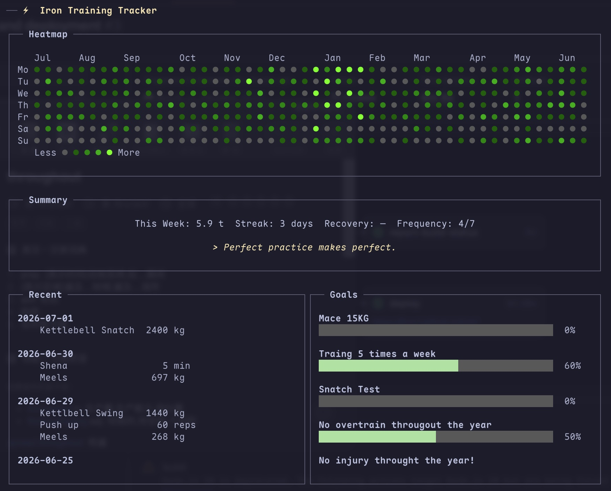

# iron

English | [中文版](README_zh.md)

A terminal UI for tracking training. Log practices set-by-set, review history, and visualize consistency. All data stays local in a single SQLite file.



## Philosophy

- **Terminal-native**: keyboard-driven, fast, distraction-free
- **Local-first**: your data lives in `~/.iron/iron.db`, nowhere else
- **Minimal**: no accounts, no sync, no bloat — just training records

## Features

- **Set-by-set logging** with weight carry-forward, warm-up/cool-down, notes
- **Edit or delete committed sets** without re-entering the whole log
- **History** with filter, inline detail popup, edit, delete, undo
- **Trends** — sparkline charts per practice with time-window control
- **GitHub-style heatmap** on the Dashboard
- **Goals & milestones** with progress bars
- **Daily quotes** on the Dashboard, managed via Quotes screen
- **HRV tracking** — record a 0–100 score each morning
- **4 practice types**: Weight x Reps, Reps Only, Distance (km), Duration (min)
- **JSON export/import** for backup
- **Vim navigation** (j/k, h/l, /, Enter, Esc) + Emacs text input (Ctrl+A/E/B/F/K)
- **i18n**: English and Chinese (Simplified)

## Installation

Requires Rust 1.70+.

```bash
git clone https://github.com/jhou1/iron.git
cargo build --release
cp target/release/iron ~/.local/bin/
```

## Usage

```bash
iron              # English
LANG=zh_CN.UTF-8 iron  # Chinese
```

### Navigation and screen re-entry

The existing Dashboard routes and shortcuts are unchanged. Opening Dashboard, History, Trends, Practices, Goals, or Quotes reloads current database data before switching screens. Where applicable, Iron restores the same item by stable ID together with the active filter, viewport, focused detail, and Trends time window. Unfinished add/edit/date/delete-confirmation state, old status messages, and cross-page undo payloads are cleared when a screen is re-entered.

History edit navigation carries the selected log's stable ID, so the Log Entry form opens the exact requested log even after data changes. Target preparation is atomic: if a destination cannot refresh, Iron remains on the source screen, preserves its in-place state and the cached destination, and shows an error. Batch 3A ships this lifecycle behavior. Batch 3B-1 Practices, Batch 3B-2 Quotes, Batch 3B-3 Trends, Batch 3B-4 History, Batch 3B-5 Goals, Batch 3B-6 Dashboard, and Batch 3B-7 Log Entry are shipped. Goals is the approved presentation redesign in this rollout.

Batch 3B-6 moves Dashboard outer-frame and static-panel presentation ownership to shared components with no visual or shortcut change. Batch 3B-7 moves Log Entry presentation ownership to shared frames, one shared list panel, and four bounded panels with no visual, shortcut, route, or lifecycle change.

### Dashboard

The home screen shows the 52-week heatmap, weekly summary and streak, recent activity, active goals, a daily quote, and today's HRV. Its shared frame reserves status and active-mode shortcut rows, and four shared static panels provide the Heatmap, Summary, Recent, and Goals presentation bounds. Dashboard retains the content formatting and workflows. The responsive layout keeps each section inside its panel at the supported `80x35` size and remains bounded in smaller direct-render rectangles.

| Key   | Action                  |
|-------|-------------------------|
| `l`   | Log a practice          |
| `h`   | History                 |
| `t`   | Trends                  |
| `e`   | Practices               |
| `g`   | Goals                   |
| `Q`   | Quotes                  |
| `v`   | Record today's HRV      |
| `Esc` | Quit                    |

The footer always describes the active mode. While entering HRV it shows only confirm/cancel, and quit confirmation shows only its confirmation actions. HRV must be an integer from 0 to 100; validation or database-save failures leave the editor and entered value in place with an error status.

### First Time Setup

1. Press `e` to open **Practices**
2. Press `a` to add a practice, name it, press Enter
3. Select the type with `j/k` and press Enter:
   - **Weight x Reps** — tracks kg and reps
   - **Reps Only** — bodyweight reps
   - **Distance** — km
   - **Duration** — minutes
4. Press `Esc` to return to Dashboard

### Logging

Press `l` to open the Log Entry screen.

1. Filter or navigate with `j/k`, press Enter to select a practice
2. Enter sets:
   - Type weight, Tab to reps, type reps, Enter to commit
   - For weighted practices, weight carries forward; just type reps and Enter
3. `Tab` cycles sections: sets → warm-up → cool-down → RPE → note
4. `j/k` to navigate committed sets; `e` to edit, `d` to delete
5. `D` to change the log date
6. `Ctrl+S` saves only after at least one set is committed and no set or date edit is pending
7. `Esc` to cancel

The practice selector clamps at the first and last result and adds `↑`, `↓`, or `↑↓` to its title when results are outside the visible viewport. Every single-line field scrolls horizontally to keep its Unicode cursor visible. The footer changes with the active filter, field, set-edit, date-edit, and exit-confirmation mode. Validation and database-save failures retain the form, cursor, focus, and return destination while showing an error status.

### History

Press `h`. The shared frame owns filter, list, status, and shortcut allocation, while the shared list panel owns the border, overflow, viewport, header, and selected-row highlight. History retains log formatting, filtering, detail, editing, delete/undo, and re-entry. The list previews the selected log in a wrapped detail panel. Press `Enter` to focus and scroll the complete detail.

| Key | Action |
|---|---|
| `j/k` | Navigate |
| `Enter` | Focus selected detail; `j/k` scrolls it |
| `/` | Filter by practice name |
| `e` | Edit log |
| `d` | Delete log |
| `u` | Undo last deletion |
| `Esc` | Back |

### Trends

Press `t`. Select a practice to view its sparkline chart.

| Key | Action |
|---|---|
| `j/k` | Navigate practice list |
| `h/l` | Adjust time window (±30 days, 30–365) |
| `/` | Filter practice list |
| `Esc` | Back |

### Practices

Press `e` to manage your practice inventory.

| Key | Action |
|---|---|
| `j/k` | Navigate |
| `a` | Add practice |
| `e` | Rename |
| `Space` | Toggle active/inactive |
| `d` | Delete |
| `Esc` | Back |

Long practice names stay inside the list, and failed add/rename/delete operations keep the active form available with an error.

### Goals

Press `g`. Goals uses persistent Goals/Milestones panes: at body widths of `>=83` cells they appear side by side, and below 83 they stack. The selected Goal remains visible in the Goals pane while its aggregate progress stays pinned above independently scrolling milestone rows. Goal progress remains derived from milestone completion.

Goal list:

| Key | Action |
|---|---|
| `j/k` | Navigate goals |
| `a` | Add goal |
| `e` | Rename selected goal |
| `Enter` | Focus the selected goal's milestone panel |
| `m` | Add a milestone directly |
| `Space` | Toggle goals without milestones |
| `D` | Edit a completed goal's date |
| `d` / `u` | Delete / undo deletion |
| `Esc` | Back to Dashboard |

Milestone panel:

| Key | Action |
|---|---|
| `j/k` | Navigate every milestone; the panel scrolls as needed |
| `a` | Add milestone |
| `Enter` / `e` | Rename selected milestone |
| `Space` | Toggle completion and refresh goal progress |
| `D` | Edit a completed milestone's date |
| `d` / `u` | Delete / undo deletion |
| `Esc` | Return to the goal list |

Goals with milestones show `completed/total · percentage`; their completion state is derived from the milestone states. `Esc` cancels Goal add/edit/date/delete-confirmation modes directly to Goal Browse, while milestone add/edit/date/delete-confirmation modes cancel to Milestones Browse. From there, `Esc` returns from Milestones Browse to Goal Browse and then from Goal Browse to Dashboard. Database behavior, navigation, atomic refresh failure handling, re-entry restoration/reset rules, mutation-failure retention, and goal/milestone undo remain unchanged.

### Quotes

Press `Q`. The list keeps each row compact while the selected quote is shown completely in a wrapped preview.

| Key | Action |
|---|---|
| `j/k` | Navigate quotes |
| `Enter` | Focus the complete preview; `j/k` scrolls it |
| `a` / `e` | Add / edit a quote |
| `d` / `u` | Delete / undo deletion |
| `Esc` | Return from detail focus or go back |

## Data

Stored in `~/.iron/iron.db` (SQLite). Back up by copying the file, or use JSON export:

```bash
iron export backup.json
iron import backup.json    # skips duplicates
```

The app auto-migrates data from the old `~/.ironcli/` directory on first launch.

Quick Log and its LLM configuration/runtime have been permanently removed without a replacement workflow. The supporting Abbreviations API and table are also removed: opening an existing database drops the `abbreviations` table and permanently deletes those rows while preserving training logs, practices, goals, quotes, HRV, and other unrelated data.

## Keyboard Reference

### Text Input (all fields)

| Key | Action |
|---|---|
| `Ctrl+B` / Left | Cursor back |
| `Ctrl+F` / Right | Cursor forward |
| `Ctrl+A` / Home | Start of line |
| `Ctrl+E` / End | End of line |
| `Ctrl+K` | Delete to end |
| `Backspace` | Delete before cursor |
